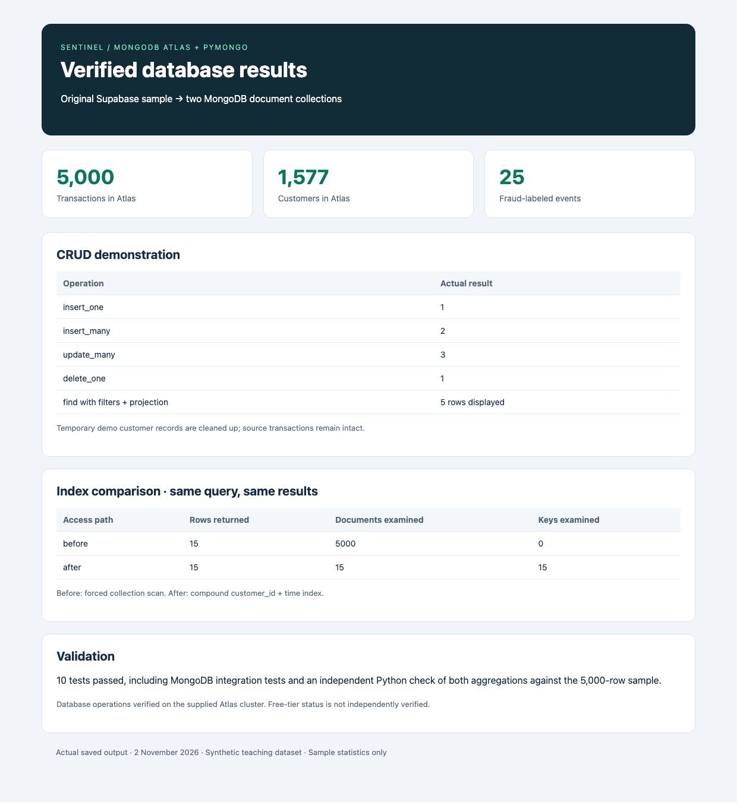
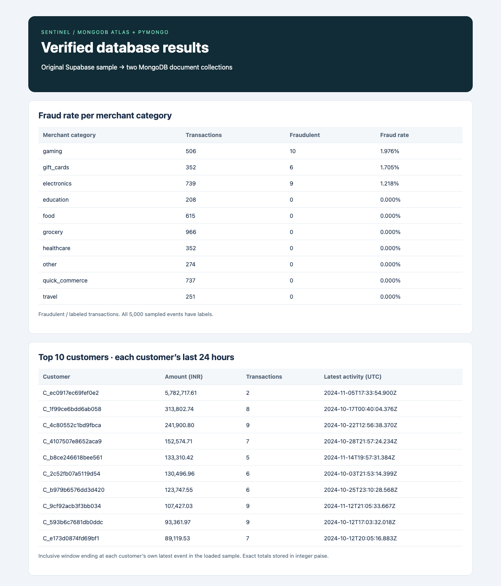

# SENTINEL: MongoDB Atlas + Python

A document-database version of the SENTINEL Project Work 4/5 dataset. Python reads a 5,000-row sample from the existing Supabase load, joins customer, merchant, device and fraud-label records, and writes two collections to MongoDB Atlas.

The source is the original **synthetic SENTINEL teaching dataset**, not newly generated replacement data. Amounts are INR integer paise. This is a database modelling exercise, not a trained fraud-detection model.

## Setup

Use Python 3.11 or newer and MongoDB 5.0 or newer (the rolling-window pipeline uses `$setWindowFields`).

```bash
python3 -m venv .venv
source .venv/bin/activate
pip install -r requirements.txt
cp .env.example .env
```

Fill `.env` locally. It is ignored by Git, as are downloaded source records. No EURI, Qdrant, embedding, or checkpoint configuration is needed. `MONGODB_DB` is a database name, **not** a PostgreSQL connection string.

```dotenv
MONGODB_DB=sentinel_project
SOURCE_SCHEMA=public
```

Set `MONGODB_URI` to your Atlas driver URI and `DATABASE_URL` to the Supabase PostgreSQL URI. Percent-encode password characters such as `@` as `%40`; do not encode the whole URI. For a Supabase pooler, use its exact supplied host, port and username. The loader only reads Supabase and never modifies its tables.

### Atlas free cluster, user and IP access

1. Sign in to [MongoDB Atlas](https://cloud.mongodb.com/), create a project and choose a **Free / M0** cluster if you do not already have one. Avoid selecting a paid tier for this assignment.
2. In **Database Access**, create a password-authenticated database user. Assign `readWrite` on `sentinel_project` using a specific database privilege, or the broader read/write role if required by your class setup.
3. In **Network Access**, add your current public IP. Update the entry if your connection changes.
4. Choose **Connect → Drivers → Python**, copy the URI into `.env`, and supply the encoded password.
5. Run `python -m sentinel check`. A successful `ping` checks connectivity; the actual load verifies write access.

This project reuses the supplied Atlas cluster. A database password does not authorize Atlas control-plane provisioning; the cluster's free-tier setting and user/IP settings must be checked in the Atlas console. See the official [Atlas connection guide](https://www.mongodb.com/docs/atlas/connect-to-database-deployment/) and [IP access instructions](https://www.mongodb.com/docs/atlas/security/ip-access-list/).

## Run

```bash
# End-to-end: read Supabase, validate, load Atlas, CRUD, explain, aggregations
python -m sentinel all --source supabase --limit 5000

# Or run each stage separately
python -m sentinel prepare --source supabase --limit 5000
python -m sentinel load
python -m sentinel crud
python -m sentinel indexes
python -m sentinel aggregate
```

The sample is selected deterministically by `transaction_id` from Supabase's `public` tables. It includes warmup data and is not a representative random sample. The query joins `transactions`, `customers`, `merchants`, `devices`, and `labels`. Missing customer/merchant joins cannot satisfy the minimum-row requirement silently; missing non-null device references are rejected. Unknown labels stay null, never become legitimate transactions.

`prepare` saves a private, reusable BSON Extended JSON sample under `outputs/private/`. `load` uses source IDs as `_id` and upserts in batches of 500; rerunning the same sample does not duplicate records. A larger or different sample adds transactions, rather than deleting existing data. Use a fresh database to compare independent samples. Customer device lists describe the most recently prepared sample.

A complete original CSV export is also supported:

```bash
python -m sentinel all --source csv --limit 5000
```

Set `SENTINEL_DATA_DIR` to the export root containing `tables/`. CSV input is strictly validated. The partial Desktop export found during development contained nonmatching dimension/label partitions and malformed content, so the verified run uses the existing Supabase load instead. No source SQL schema is recreated and no synthetic labels are substituted.

## Document design: exactly two collections

### `customers`

```javascript
{
  _id: "C_…", customer_id: "C_…",
  created_at: ISODate("2024-01-01T00:00:00Z"),
  customer_age: 30, home_city: "Pune", region: "west",
  devices: [{device_id: "D_…", device_kind: "mobile"}],
  devices_scope: "observed_in_loaded_sample"
}
```

Devices are **embedded** as deduplicated, small snapshots because a customer profile can retrieve its observed devices in one read. SENTINEL's device table has no owner field; the relationship is derived from observed transactions, and a shared device can appear under more than one customer. This is not a complete inventory or a claim of exclusive ownership. For an unbounded production device history or centrally mutable device metadata, use a separate referenced device collection.

### `transactions`

```javascript
{
  _id: "TX_…", transaction_id: "TX_…", customer_id: "C_…",
  customer: {customer_age: 30, location: {city: "Pune"}},
  merchant: {merchant_id: "M_…", name: "Synthetic Merchant …", location: {city: "Delhi"}},
  merchant_category: "food", device: {device_id: "D_…", device_kind: "mobile"},
  amount_paise: 12345, currency: "INR", time: ISODate("2025-01-01T00:00:00Z"),
  payment_channel: "UPI", fraud_label: 0,
  label_available_at: ISODate("2025-03-02T00:00:00Z"), split: "train", source: "SENTINEL"
}
```

Transactions **reference** their customer with `customer_id` because transaction history grows indefinitely and should not inflate one customer document toward MongoDB's document-size limit. Small customer/merchant/device snapshots are embedded in each transaction for independent filtering and analysis. Event customer age and locations come from the transaction; merchant names and device kinds come from current source dimensions. These dimension snapshots are not guaranteed historical versions. Referencing is application-level: MongoDB does not enforce this foreign key.

`transaction_time` maps to `time` as a UTC BSON date. Integer paise is authoritative and is checked against the original rupee amount using `Decimal`; calculations do not sum floating-point currency.

## Required operations and indexes

See [`sentinel/cli.py`](sentinel/cli.py):

- `insert_one` creates one disposable demo customer.
- `insert_many` creates two more demo customers.
- `find` filters transactions by customer and positive amount, projecting only customer, amount and time.
- `update_many` marks the three demo customers reviewed.
- `delete_one` removes one demo customer; a `finally` block removes any remaining records from that unique demo run.

Real source records are not deleted by the CRUD demonstration.

Indexes: unique `customers.customer_id`, `transactions.customer_id`, `transactions.time`, and compound `(customer_id, time)`. For the same customer/time query, `Cursor.explain()` is recorded before and after index creation. The baseline explicitly hints `$natural` to force a collection scan, and the indexed run hints the compound index. This makes repeated runs reproducible without dropping existing indexes. It demonstrates access paths, not an unbiased claim about the optimizer's automatic choice or elapsed-time performance.

Full plans and `executionStats` are saved in `outputs/explain_before.json` and `outputs/explain_after.json`. Compare documents examined, keys examined, returned rows and the `COLLSCAN`/`IXSCAN` plan stages. See [PyMongo aggregation documentation](https://www.mongodb.com/docs/languages/python/pymongo-driver/current/aggregation/).

## Aggregation definitions

The two executable pipelines are in [`sentinel/queries.py`](sentinel/queries.py).

1. **Fraud rate by merchant category:** count fraud labels equal to 1, divide by known labels (0 or 1), and report total/labeled/fraudulent counts. A category without labels has a null rate. Multiply the stored fraction by 100 for a percentage. The labels are retrospective, not model predictions.
2. **Top 10 customers by amount in their last 24 hours:** use a window partitioned by customer to find each customer's own latest activity; retain transactions in the inclusive interval `[latest − 24 hours, latest]`; sum integer paise, sort descending and limit to 10. Ties use ascending customer ID. This is neither the last 24 hours from today's clock nor a global dataset cutoff.

Both results describe **the loaded sample only**, not complete customer histories or population-wide fraud rates. The events include authorization attempts and are not a settlement ledger.

## Outputs and screenshots

`outputs/source_validation.json` records source provenance and counts. Other output files record the actual database load, CRUD operations, explain statistics and aggregation results. Raw source samples stay private. Public outputs contain aggregate statistics and pseudonymous IDs from the synthetic teaching dataset, never connection strings.

See [`docs/RESULTS.md`](docs/RESULTS.md) for the verified run. Screenshots are of the generated results report, not the Atlas administration console.





## Tests

```bash
pip install -r requirements-dev.txt
python -m pytest -q
# To run database integration tests as well:
TEST_MONGODB_URI=mongodb://127.0.0.1:27017 python -m pytest -q
```

Without `TEST_MONGODB_URI`, integration tests are explicitly skipped. Use a disposable local MongoDB: tests create unique `sentinel_test_*` databases and delete only those databases. Tests cover exact money conversion, timezone normalization, device deduplication, missing labels, invalid inputs, inclusive 24-hour boundaries, per-customer cutoffs, and an independent Python comparison against the prepared sample (when present).

## Troubleshooting and submission

- `CERTIFICATE_VERIFY_FAILED`: the app supplies `certifi`'s CA bundle for Atlas. Never disable TLS verification.
- Connection timeout: check cluster status, current public IP access, DNS and outbound network access.
- Authentication failure: verify the database username and URL-encoded password, not your Atlas website login.
- Permission failure: give the database user read/write access to `sentinel_project`.
- Supabase connection failure: use the supported direct/pooler endpoint and `SOURCE_SCHEMA=public` for this load.
- Driver errors are summarized without dumping URIs or source records.

Keep `.env` private, use `.env.example` in the public repository, and rotate credentials that have been shared in chat. Before publishing, inspect `git status` and `git check-ignore .env outputs/private/sample.json`.
