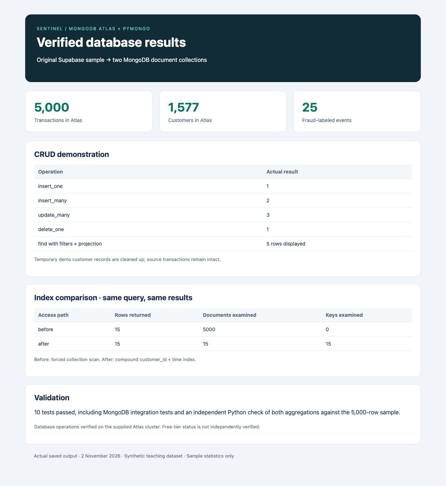
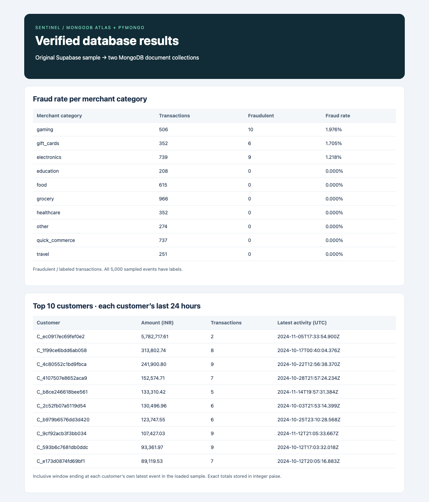

# Verified results — 2 November 2026

Source: the existing Supabase `public` SENTINEL tables, selected by transaction ID. Destination: the supplied MongoDB Atlas cluster, database `sentinel_project`. Atlas TLS verification was enabled using the `certifi` CA bundle.

| Check | Result |
| --- | --- |
| Source transactions / Atlas transactions | 5,000 / 5,000 |
| Atlas customers | 1,577 |
| Transactions with known labels | 5,000 |
| Fraud-labeled transactions | 25 (0.5% of sample) |
| Sample interval (UTC) | 2024-09-30 18:35:15.602 to 2024-11-15 13:46:28.423 |
| `insert_one` / `insert_many` | 1 / 2 |
| `update_many` / `delete_one` | 3 / 1 |
| Query rows returned before / after | 15 / 15 |
| Documents examined before / after | 5,000 / 15 |
| Keys examined before / after | 0 / 15 |
| Tests | 10 passed |

Fraud rates: gaming **1.976%**, gift cards **1.705%**, electronics **1.218%**; the other seven categories had zero observed fraud labels in this sample. These are retrospective sample statistics.

The largest last-24-hour customer total was **578,271,761 paise (INR 5,782,717.61)** across two transactions. The pipeline was checked against an independent Python calculation on the same source sample.

Screenshots below capture locally rendered HTML reports populated from real Atlas output files. They are not Atlas console screenshots. Regenerate the reports with `python scripts/build_report.py`; open `overview.html` and `aggregations.html` in a browser and capture the page after a fresh run.

## Evidence files

- [Source validation](../outputs/source_validation.json)
- [Loaded collection counts](../outputs/load.json)
- [CRUD output](../outputs/crud.json)
- [Index comparison](../outputs/index_comparison.json)
- [Before explain plan](../outputs/explain_before.json)
- [After explain plan](../outputs/explain_after.json)
- [Aggregation results](../outputs/aggregations.json)

The supplied Atlas cluster and database user were reused; creating a new cluster/user was unnecessary. Successful writes prove effective database write access and an operational network path. The M0/free tier and exact configured Atlas role/IP rule were not independently inspected because database credentials do not grant Atlas administration access. Confirm those settings in the Atlas console for the provisioning portion of the assignment.
